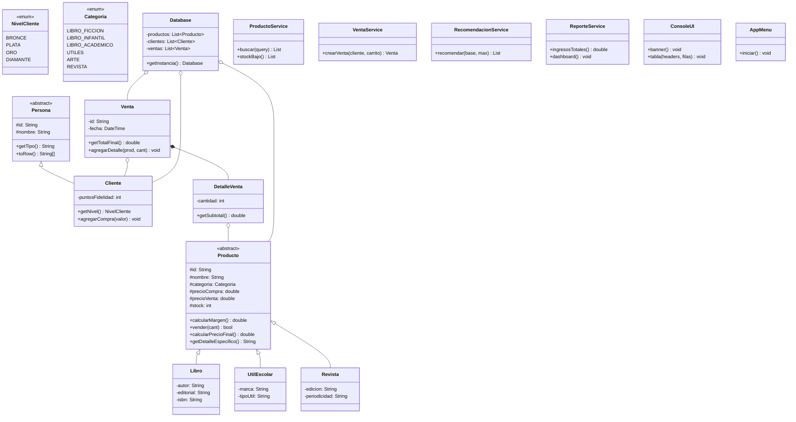

# 📚 Lumina Librería — Diagrama de Clases

> Pégalo en [plantuml.com/plantuml](https://www.plantuml.com/plantuml/uml/) o en VS Code con la extensión PlantUML para visualizarlo.
> El archivo fuente está en `docs/diagrama-clases.puml`.

## Versión Mermaid (para GitHub / Notion)

## Cómo leerlo (para tu exposición)

| Relación | Ejemplo | Significado |
|---|---|---|
| `Persona <|-- Cliente` | Herencia | Cliente **es-una** Persona |
| `Producto <|-- Libro/Util/Revista` | Herencia + polimorfismo | Cada tipo calcula su precio/detalle distinto |
| `Venta *-- DetalleVenta` | Composición | Sin venta no existen sus detalles |
| `Venta o-- Cliente` | Agregación | La venta referencia un cliente que vive fuera |
| `Database o-- Producto` | Agregación | La BD en listas **contiene** productos temporales |
| `AppMenu ..> Service` | Dependencia | El menú **usa** los servicios |
