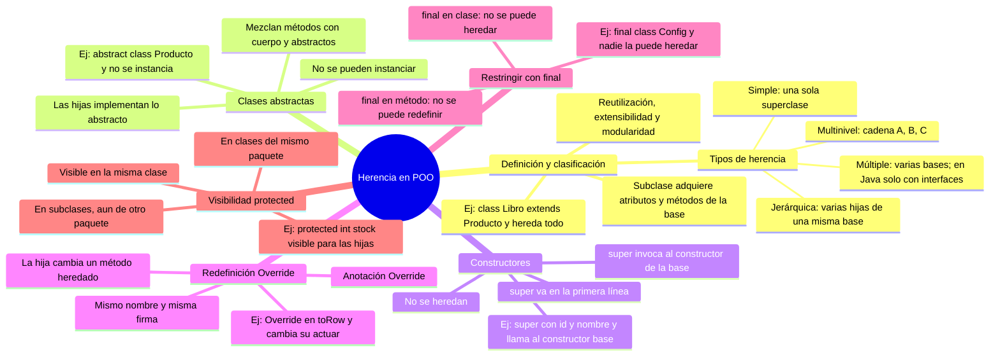

# Mapa mental — La Herencia en la POO

> Pega solo el bloque `mermaid` en [mermaid.live](https://mermaid.live), GitHub o Notion.
> Imagen bonita: `mapa-mental-herencia-poo.png` (generada con Python + Pillow).
> Ramas según rúbrica: definición y clasificación, abstractas, constructores,
> redefinición, final, protected — con ejemplos Java y relaciones entre ramas.

## Relaciones entre ramas (flechas del PNG)
- De la hoja *"Las hijas implementan lo abstracto"* a la hoja *"Anotación Override"*:
  lo abstracto *se implementa con @Override* (por eso se conectan).
- De *Restringir (final)* a *Redefinición*: *final impide redefinir*.

## Fuentes (del PDF)
- Deitel & Deitel (2016) · Barnes (2007) · Joyanes (1996) · López (2006) · Wu (2008)

## Equipo
Miguel Quiroga — Universidad del Tolima
